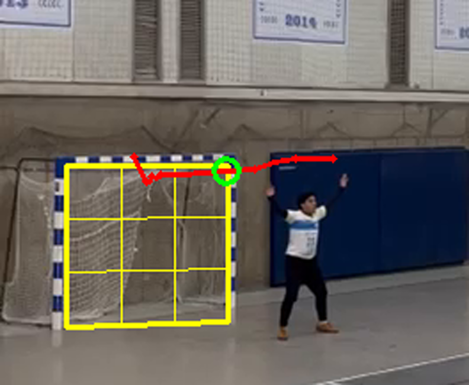

# Análisis de lanzamientos al arco en balonmano

Proyecto del ramo **TEL-328 Procesamiento Digital de Imágenes** (UTFSM).

La idea salió de una reunión con la Federación de Balonmano de Chile: tener una herramienta que, a partir del video de una cámara apuntando al arco, detecte cada lanzamiento y diga hacia qué zona del arco fue, si terminó en gol, si el arquero atajó (y dónde) y, si se puede, a qué velocidad iba el balón.



## Estado actual

- [x] Estabilización de video grabado con cámara en mano (ORB + homografía con RANSAC).
- [x] Arco marcado una vez por video y grilla de 3x3 zonas mediante homografía al plano del arco (300 x 200 cm).
- [x] Detección del balón por diferencia de 3 cuadros, con filtro por tamaño y descarte de jugadores.
- [x] Seguimiento del balón con modelo de velocidad constante.
- [x] Clasificación básica: gol cuando el balón entra al arco y la red lo frena.
- [ ] Fine-tuning de YOLO con un dataset propio.
- [ ] Distinguir atajada y registrar dónde ataja el arquero.
- [ ] Estimar la velocidad del lanzamiento.
- [ ] Estadísticas de partido completo (versión futura).

## Estructura

```
src/
  pipeline_balon.py   pipeline clásico: estabilización, detección y seguimiento del balón
  demo_arco.py        demo para cámara fija frontal: YOLO o sustracción de fondo + zona del arco
docs/                 resultados de ejemplo (video en cámara lenta, figura, CSV)
videos/               poner aquí los videos (no se suben al repo)
salida/               resultados generados (no se suben al repo)
```

## Instalación

```bash
python -m venv .venv
source .venv/bin/activate        # en Windows: .venv\Scripts\activate
pip install -r requirements.txt
```

`ultralytics` solo hace falta para `demo_arco.py --metodo yolo`.

## Uso

### Video grabado en mano (pipeline_balon.py)

Se elige un cuadro de referencia donde se vea bien el arco y se pasan sus 4 esquinas interiores en ese cuadro (superior izquierda, superior derecha, inferior derecha, inferior izquierda):

```bash
python src/pipeline_balon.py videos/tiro.mp4 --ref 180 \
    --esquinas 37,399 128,399 128,487 37,490 --hasta 330 --salida salida
```

Genera en `salida/`:

- `demo_balon.mp4`: video original con el arco seguido y la trayectoria del balón.
- `demo_zoom_lento.mp4`: zoom al arco en cámara lenta, junto a la máscara de movimiento.
- `trayectoria_balon.png` y `trayectoria_balon.csv`.
- `resultado.txt`: resultado del lanzamiento y zona.

Para sacar las coordenadas de las esquinas se puede exportar el cuadro de referencia y mirarlo en cualquier visor de imágenes:

```bash
python -c "import cv2; c=cv2.VideoCapture('videos/tiro.mp4'); c.set(1,180); cv2.imwrite('ref.png', c.read()[1])"
```

### Cámara fija frontal al arco (demo_arco.py)

Pensado para el montaje definitivo: celular en trípode detrás del lanzador, mirando al arco, a 60 fps. Al partir pide hacer click en las 4 esquinas del arco.

```bash
python src/demo_arco.py videos/sesion.mp4                  # YOLO pre-entrenado (clase "sports ball")
python src/demo_arco.py videos/sesion.mp4 --metodo fondo   # sustracción de fondo
```

Genera el video anotado, un CSV con cada lanzamiento y un mapa del arco con todos los tiros.

## Cómo funciona el pipeline

1. **Estabilización:** se buscan puntos ORB en la parte estática de la imagen (pared y arco) y se calcula una homografía de cada cuadro al de referencia. Con eso el arco queda fijo aunque la cámara se mueva.
2. **Arco:** con las 4 esquinas se calcula la homografía imagen → plano del arco, que se usa para dibujar la grilla y para convertir posiciones a centímetros.
3. **Balón:** se hace la diferencia entre los cuadros t-2, t y t+2 del video estabilizado y se combinan, lo que deja solo lo que se movió en el cuadro t. Después se aplica umbral, morfología y filtro por tamaño, y se descartan las manchas pegadas a objetos grandes (jugadores).
4. **Seguimiento:** los candidatos se unen entre cuadros con predicción de velocidad constante. La pista del balón es la que tiene la racha más larga de pasos rápidos y en la misma dirección.
5. **Resultado:** se busca el punto donde la trayectoria entra al arco. Si después de entrar el balón se frena (la red lo detiene), se marca como gol.

## Limitaciones conocidas

- Con video comprimido (WhatsApp) el balón mide unos 5 píxeles, lo que está en el límite de lo detectable.
- Grabando de lado, la fila de la zona es confiable pero la columna no. Por eso el montaje definitivo es con cámara fija y frontal.
- Las esquinas del arco se marcan a mano una vez por video.

## Equipo

- Matías Ramos
- Ignacio Cubillos
- Bruno Yáñez
